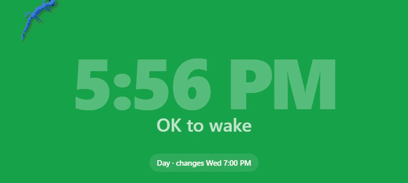

<div align="center">

# Color Clock

**A glanceable "OK to wake" light for kids, built from a spare Android phone.**

[](../../releases/latest)
[](https://github.com/Giblicious/color-clock/actions/workflows/ci.yml)




</div>

The whole screen is one color that changes on a schedule: green means "you can get up", red means "stay in bed". Kids who can't read a clock yet only need to see the color. A pixel gecko lives on the screen too. It's awake when they can be, and asleep when they should be.

Color Clock comes in two forms:

| | Android app | Web page |
|---|---|---|
| **Best for** | A dedicated bedside display | Trying it out, or any screen with a browser |
| **Runs** | Full screen, from boot, locked down | In a browser tab |
| **Settings** | Full-screen, protected by a child lock | Stored in the browser |
| **Updates** | Installs itself from GitHub releases | Whatever the host serves |

## Contents

- [Features](#features)
- [Install on a phone](#install-on-a-phone)
- [Using it](#using-it)
- [Web version](#web-version)
- [How it works](#how-it-works)
- [Development](#development)
- [Credits](#credits)

## Features

**The display**
- A day and a night color, each with its own start time, screen brightness, and optional label ("OK to wake" / "Stay in bed").
- Optional large clock and a small "next change" reminder.
- A slow 15-second fade at sunrise and sunset: color, text, label, brightness and the gecko all change together.
- The text color adapts so it stays readable on any background. Everything shifts a few pixels each minute to prevent burn-in.

**The gecko** (on by default, switch it off under **Display**)
- **By day** it explores, climbs over the clock digits and the reminder, and hunts the flies and crickets that wander in. Tap anywhere away from it to call one over.
- **Ball:** now and then a ball rolls in for it to play with, until the ball pops.
- **Petting:** hold a finger on the gecko.
- **Ten minutes before night** it gets sleepy and heads to bed.
- **At night** it sleeps in darker colors that won't catch the eye, and ignores touches.
- **In the morning** it wakes as the color changes and does a few push-ups.

**Built for a kid's room**
- **Child lock.** Taps do nothing and the power menu is hidden. Settings open only with a hold in the corner plus a code written out in words (details [below](#child-lock)).
- **Kiosk mode.** It becomes the home screen, hides the status and navigation bars, skips the lock screen, and keeps the screen on while plugged in. Bars that get pulled down hide again by themselves.
- **Hands-off updates.** It checks this repo's releases every 6 hours and installs new versions silently.

## Install on a phone

**You need:** an Android 8.0+ phone you can dedicate to this, a USB cable, and [`adb`](https://developer.android.com/tools/adb) on a computer.

1. **Prepare the phone.** Factory-reset it, or remove every account from it. Android only allows a device owner app on a phone with no accounts. Then turn on **Developer options → USB debugging**.
2. **Install the app** using the latest `color-clock-*.apk` from [Releases](../../releases/latest):

   ```sh
   adb install color-clock-*.apk
   ```

3. **Make it the device owner.** This enables kiosk mode and silent updates:

   ```sh
   adb shell dpm set-device-owner com.giblicious.colorclock/.AdminReceiver
   ```

4. **Start it:**

   ```sh
   adb shell am start -n com.giblicious.colorclock/.MainActivity
   ```

Unplug it, set it on the nightstand, and plug it into a charger.

> [!NOTE]
> Step 3 is optional. Without it the app still works, but there's no kiosk lockdown and Android asks for confirmation on every update.

**Removing it later:** open settings → **Device** → **Hold to release device owner**, then uninstall it like any other app.

## Using it

### Settings

Tap the screen, then the gear. The settings fill the screen in four tabs, laid out to fit a landscape phone with nothing to scroll:

| Tab | What's there |
|---|---|
| **Schedule** | Start time, color, label and brightness for day and night |
| **Display** | Clock, reminder and gecko on/off |
| **Child lock** | Turn the lock on or off |
| **Device** | Version, kiosk and battery status, **Check for update**, unlock or release the device |

Dragging a brightness slider previews it on the screen. Settings close without saving after two minutes untouched.

### Child lock

With the child lock on:

1. Hold the **top-right corner** for 3 seconds. A ring fills up while you hold.
2. Type the code shown **in words**, for example *"Five Two Eight Zero"* → `5280`.

The code is new every time, so there's nothing to remember. A child who can't read yet can't get in. The code screen goes back to the clock after three wrong codes, or after ten seconds untouched.

## Web version

The same display runs in any modern browser, gecko included. Move the pointer or tap to show the gear; settings are saved in that browser.

```sh
npm run dev                                   # http://127.0.0.1:8088
docker build -t color-clock . && docker run -p 8088:80 color-clock
```

Or upload `public/` to any static host. There's no build step.

> [!NOTE]
> Browsers limit what a page can do. Fullscreen needs a tap, the screen only stays awake while the page is visible, and offline support needs HTTPS (or `localhost`). The Android app has none of these limits.

## How it works

```
android/   Android app (Java): kiosk, child lock, settings, updater
public/    Web display: the page both versions show
pet/       The gecko: engine (pet/engine/) and its adapter for the clock (pet/clock.ts)
tools/     Dev server and release script
```

- **One display, two hosts.** The Android app shows the same page as the web version, bundled into the APK and running offline in a WebView. The app's own settings drive it.
- **The gecko's world is the page.** `pet/clock.ts` turns the clock digits and the reminder into terrain the gecko can climb, using the real letter shapes. It also maps the schedule onto the gecko's day.
- **Updates.** The app reads this repo's latest GitHub release. If there's a newer `color-clock-<versionCode>.apk`, it downloads it, checks the file against the release's SHA-256 digest, and installs it. As device owner that happens silently.

## Development

**Requirements:** Node 22+. For the app: the Android SDK and JDK 17+ (Android Studio's bundled JDK is found automatically on Windows). For releases: the [GitHub CLI](https://cli.github.com/).

```sh
npm install
npm run dev                # web version with live files
npm run check              # typecheck, syntax checks and tests (runs in CI)
npm run pet:build          # rebuild public/pet.js after changing pet/
```

`public/pet.js` is committed, so the web version runs without a build step.

### Building the app

```sh
npm run android:build      # build a signed APK
npm run android:release    # bump the version, build, and publish a GitHub release
```

A new release reaches every installed phone within 6 hours, or right away from **Device → Check for update**.

> [!IMPORTANT]
> Releases are signed with a key in `android/signing/`, which isn't in git. Android only installs an update signed with the same key, so keep a backup of that folder.

To build and publish your own copy:

1. Create a keystore and an `android/signing/signing.properties` containing `storeFile`, `storePassword`, `keyAlias` and `keyPassword`.
2. Point `Updater.java` and `tools/android-release.mjs` at your own repository.

## Credits

The gecko is adapted from [Pixel Pet](https://github.com/spreadwell/pixel-pet) by Spreadwell and used under the MIT License. Its engine and license are in [`pet/engine/`](pet/engine/).
